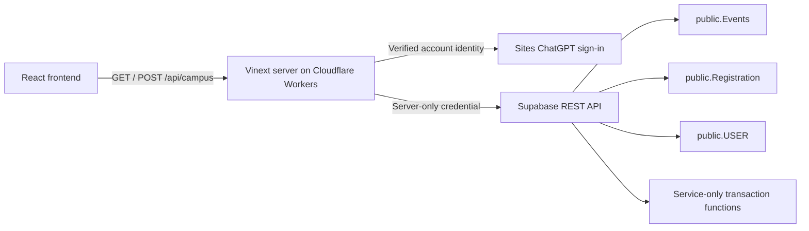

# Architecture

CampusConnect keeps the supplied HTML design as editable React components and uses a same-origin server API to connect to Supabase. No Supabase server credential is delivered to the browser.

## Frontend

`app/reference-ui.tsx` contains the header, attendee dashboard, and footer derived directly from the supplied HTML. `app/reference-theme.css` preserves its design tokens and Material Symbols. `app/campus-app.tsx` supplies navigation and event/student/organiser flows. Hash-based routes keep all screens within one application shell.

## API and identity

`app/api/campus/route.ts` selects the configured backend. `lib/supabase-backend.ts` adapts the actual capitalised Supabase table names and fields to the frontend contract. `lib/supabase-model.ts` is the mapping layer.

Identity comes from the hosting platform's verified request headers via `getChatGPTUser()`. The server resolves the signed-in email to an existing `USER` record. If the account has no row, a deterministic UUID derived from the stable account ID is used when the user first creates an event or registers. The application never accepts the user's identity or role from browser form values.

Public reads return event information and registration counts. Personal registration records are returned only to their signed-in owner. Attendee details, event updates, and walk-in admission require the event's `organiser_id` to match the resolved current user. A `USER.role` value is not used to allow access to someone else's event.

## Transactions

The `campus_register`, `campus_update_event`, and `campus_walkin` SQL functions lock the event row while checking capacity and duplicates. They run as `SECURITY INVOKER`, have an empty search path, and can be executed only by `service_role`. Existing table RLS policies and access grants are preserved. The server authorises every call before invoking them.

## Preview and failure handling

Without a backend configuration, the explicitly labelled preview uses fictional browser-local data. Once Supabase is configured, failed database requests show an error; they do not fall back to demo data. Existing demo registrations are never uploaded to the live database.

## Current schema limits

The existing backend has only event title/capacity/timestamp, student email/role, and registration relationships/timestamp. It has no event descriptions, location, category, club relationships, cancellation state, or attendance flags. The adapter supplies clearly labelled display defaults for missing metadata and returns capability flags so unsupported writes are disabled or rejected. It does not pretend these fields were persisted.
